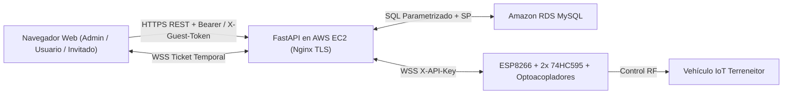
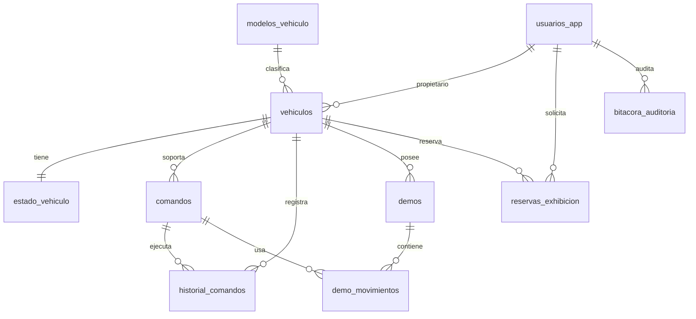

# SCARLETTE TERRENEITOR — Plataforma Integral IoT (Prácticas 4.1, 4.2 y 4.3)

Plataforma web comercial multiusuario de **Control**, **Monitoreo** y **Administración IoT** para vehículos conectados (`ESP8266` + `2 × 74HC595` + optoacopladores), desplegada con **GitHub Pages**, **FastAPI en AWS EC2**, **WebSockets seguros (WSS)** y **Amazon RDS MySQL**.

- **Frontend publicado (GitHub Pages):** https://mf-estefania.github.io/SCARLETTE-TERRENEITOR-42-preview/
- **API REST y Documentación Swagger:** https://api-terreneitor-km2026.duckdns.org/docs
- **Autoría:** Desarrollado por Karen Marín · Ingeniería en Sistemas Computacionales · Implementación de Soluciones I © 2026

---

## 1. Arquitectura General

### Módulos integrados en una sola plataforma
1. **CONTROL (4.1):** joystick táctil/teclado, botones de movimientos adicionales, `DETENER` prioritario, indicador de `Control/Luces` (ciclo de 3 pulsaciones + alternancia estimada), ejecución/cancelación de `DEMO` y movimientos personalizados por segundos o grados calibrados (`duracion_ms` local en ESP8266).
2. **MONITOREO (4.2):** último movimiento/estado persistido en RDS, historial de hasta 10 movimientos individuales más recientes (sin mezclar pasos internos de `DEMO`) y tres indicadores independientes de conectividad (**WebSocket**, **API · AWS** y **BD · RDS**).
3. **ADMINISTRACIÓN (4.3):** Dashboard con métricas reales de RDS, catálogo de modelos comerciales con imágenes/assets, inventario de unidades físicas (diferenciando modelo vs. unidad), gestión de clientes/asignaciones/restablecimiento de clave, diseñador interactivo de DEMOs y comandos por vehículo, sesiones temporales de Invitado (15 min con reserva exclusiva) y bitácora de auditoría.

---

## 2. Diagrama Entidad-Relación (RDS MySQL)

### Migraciones SQL versionadas
Ubicadas en `migraciones/` (sin secretos ni respaldos de datos):
- `migraciones/002_administracion_iot_4_3.sql`: creación de `modelos_vehiculo`, `reservas_exhibicion`, `bitacora_auditoria`, ampliación de `vehiculos` (`id_modelo`, `numero_serie`, `id_propietario`, `estado_comercial`), roles en `usuarios_app` y `tipo_demo` en `demos`.
- `migraciones/003_imagenes_modelos.sql`: adición idempotente de `imagen_url` en `modelos_vehiculo` y asignación de assets locales (`assets/img/vehiculo-*.jpg`).

> **Nota MySQL/RDS:** Las sentencias DDL (`ALTER TABLE`, `CREATE TABLE`) ejecutan *commit* implícito en MySQL, por lo que antes de migrar se realiza respaldo lógico completo (`mysqldump`) fuera del repositorio.

---

## 3. Roles y Matriz de Permisos (RBAC + BOLA/IDOR)

| Recurso / Operación | Administradora | Usuario (Comprador) | Invitado |
|---|---|---|---|
| Dashboard, Inventario, Modelos, Clientes, Auditoría (`/admin/*`) | Completo | `403 Forbidden` | `403 Forbidden` |
| Catálogo público con fotos (`/invitado/catalogo`) | Permitido | Permitido | Permitido |
| `CONTROL` en unidad `vendido` | **Bloqueado (`403` + interfaz)** | Solo unidades propias (`403` en ajenas) | `403 Forbidden` |
| `CONTROL` en unidad `mantenimiento` / `disponible` / `exhibicion` | Permitido | `403 Forbidden` | Solo `exhibicion` con reserva activa (15 min) |
| `MONITOREO` (`GET /estado`, `/historial`, `/demos`, `/comandos`) | Solo lectura en toda la flota | Solo unidades propias (`403` en ajenas) | Solo unidades en `exhibicion` (`403` en vendidas) |
| Editor de DEMOs y comandos por vehículo | Toda la flota | Solo unidades propias | No disponible |
| WebSocket (`/auth/ws-ticket` y `/ws/vehiculos/{id}`) | Autorizado por rol | Autorizado solo a unidades propias (`403` en ajenas) | Autorizado solo a unidad en exhibición |

---

## 4. Contratos REST y WebSocket (Resumen)

### Endpoints REST principales
- **Salud y Diagnóstico:** `GET /sistema/salud`
- **Autenticación y Tickets WSS:** `POST /auth/login`, `GET /auth/me`, `POST /auth/logout`, `POST /auth/ws-ticket?id_vehiculo={id}`
- **Control y Monitoreo (protegidos por rol + recurso):**
  - `GET /mis-vehiculos`
  - `GET /vehiculos/{id}/estado`
  - `GET /vehiculos/{id}/historial`
  - `GET /vehiculos/{id}/comandos`, `POST /vehiculos/{id}/comandos`, `POST /vehiculos/{id}/comandos/{id_cmd}/eliminar`
  - `POST /vehiculos/{id}/movimientos` (acepta `duracion_ms` opcional `100–12000` para movimientos personalizados)
  - `POST /vehiculos/{id}/detener`
  - `GET /vehiculos/{id}/demos`, `POST /vehiculos/{id}/demos`, `GET /vehiculos/{id}/demos/{id_demo}/movimientos`, `POST /vehiculos/{id}/demos/{id_demo}/movimientos`, `POST /vehiculos/{id}/demos/{id_demo}/movimientos/{id_mov}/eliminar` (renumeración secuencial `1..N`), `POST /vehiculos/{id}/demos/{id_demo}/iniciar`, `POST /vehiculos/{id}/demos/cancelar`
- **Administración (`/admin/*`):** `GET /admin/dashboard`, CRUD `/admin/modelos`, CRUD `/admin/unidades`, `POST /admin/asignaciones`, `GET/POST/DELETE /admin/clientes`, `PUT /admin/clientes/{id}/password`, `GET /admin/auditoria`
- **Invitado (`/invitado/*`):** `GET /invitado/catalogo`, `POST /invitado/solicitar-demo`, `POST /invitado/liberar-demo`

### Eventos WebSocket (`/ws/vehiculos/{id_vehiculo}`)
- `estado_inicial`, `movimiento_individual`, `detener_vehiculo`, `demo_inicio`, `demo_movimiento`, `demo_fin`, `demo_cancelada`, `error`.

---

## 5. Variables de Entorno del Servidor (solo nombres)

El frontend no almacena secretos ni accede directamente a RDS. En AWS EC2 el backend lee únicamente variables de entorno:
- `DB_HOST`, `DB_PORT`, `DB_USER`, `DB_PASSWORD`, `DB_NAME`
- `API_KEY`
- `CORS_ORIGINS`

---

## 6. Estructura del Repositorio Frontend

- `index.html`: pantalla de inicio de sesión responsiva (`0` scroll en escritorio, laptop, móvil vertical y móvil horizontal).
- `panel.html`: plataforma integrada de Control, Monitoreo, Administración, Mis DEMOs y Catálogo.
- `assets/css/styles.css`: estilos oscuros neón SCARLETTE y diseño Mobile First sin scroll vertical de página.
- `assets/js/`: módulos ES6 (`config.js`, `api.js`, `auth.js`, `login.js`, `panel-auth.js`, `panel-navigation.js`, `controls.js`, `lights.js`, `websocket.js`, `connections.js`, `history.js`, `last-movement.js`, `admin-view.js`, `demos-editor.js`).
- `assets/img/`: `favicon.svg`, `scarlette-terreneitor.png` y assets de modelos (`vehiculo-terreneitor.jpg`, `vehiculo-excavadora.jpg`, `vehiculo-montacargas.jpg`, `vehiculo-volteo.jpg`).
- `migraciones/`: scripts SQL versionados de Práctica 4.3.

---

## 7. Casos de Prueba Validados (P01–P17)

| Caso | Escenario | Resultado |
|---|---|---|
| P01 | Login `administradora`, `usuario`, `invitado` y rechazo `401` sin sesión | Correcto |
| P02–P04 | Alta/edición/baja de modelos, unidades, clientes y asignaciones en RDS | Correcto |
| P05 / P13 | Aislamiento BOLA/IDOR: `usuario` recibe `403` en `GET /estado`, `/historial`, `/demos`, `POST /movimientos` y `ws-ticket` de vehículos ajenos | Correcto |
| P06–P08 | Control en vivo, WSS conectado, último movimiento e historial máximo de 10 individuales | Correcto |
| P09–P10 | Creación/edición/eliminación de pasos DEMO (secuencia `1..N`), ejecución y `DETENER` prioritario | Correcto |
| P11 / P14 | Invitado en catálogo con fotos + reserva exclusiva temporal (15 min) + liberación en `Finalizar Demostración` | Correcto |
| P12 | Rechazo `403` a Invitado y Usuario en `/admin/*`, y rechazo `403` a Admin al operar unidad `vendido` | Correcto |
| P15–P17 | Reconexión WSS, responsiva `0` scroll (desktop/móvil vertical/horizontal) y registro en `bitacora_auditoria` | Correcto |

---

## 8. Limitaciones Documentadas
- **Conexión física del microcontrolador:** el indicador `WebSocket` del navegador refleja únicamente la sesión navegador ↔ servidor AWS, no confirma por sí solo que el ESP8266 esté energizado.
- **Indicador `Control/Luces`:** es una estimación local sincronizable de 3 pulsaciones (1.ª enciende control y luces; siguientes alternan luces con control activo) sin sensor físico de retorno.
- **Exhibición con 1 unidad física:** cuando no existe un segundo ESP8266 conectado directamente en `/ws/vehiculos/2`, el backend cuenta con un puente de demostración que reenvía los comandos físicos de exhibición al ESP8266 conectado en `#1` sin mezclar historiales ni sesiones web.
